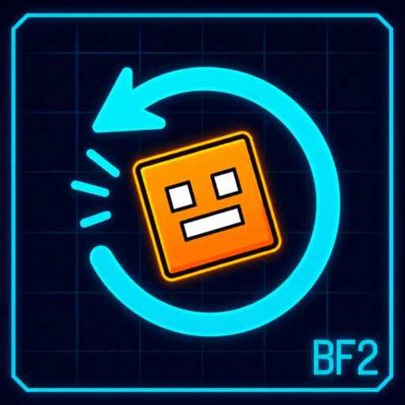

# Click Before Frames — v2.0.0

<p align="center">
  
</p>

[English](README.md) | **Bahasa Indonesia**

> **Developer:** Aluxs &nbsp;•&nbsp; **GitHub:** [@Aluxs-arch](https://github.com/Aluxs-arch)
> Mod Geode untuk Geometry Dash 2.2081 (Windows, Android, macOS; kode siap untuk iOS).

Mod Geode yang mencatat klik **sebelum** setiap frame visual, bukan di tengah
frame. Mod ini merupakan fork dari
[Click Between Frames](https://github.com/theyareonit/Click-Between-Frames)
karya theyareonit, dengan penjadwal "Before Frame" adaptif, dua bahasa (English
+ Bahasa Indonesia), dan identitas Aluxs. **v2.0.0** membuat jeda adaptif,
menambahkan preset, jeda per-input, dan diagnostik dalam game.

📐 Penjelasan mendalam: [Cara kerja "Before Frame"](docs/HOW_IT_WORKS.md)
(dua bahasa, lengkap dengan diagram timing frame/step).

## Apa itu "Before Frame"

Geometry Dash vanilla (dan CBF) mengumpulkan event input di antara dua frame
yang dirender, lalu menyimulasikan step fisika untuk frame berikutnya. CBF
klasik memutar ulang setiap klik pada posisi sub-frame yang **persis**, sehingga
batas presisi 240 TPS hilang.

**Click Before Frames** menggeser setiap klik lebih awal sebesar **jeda
(lead)**, dibatasi ke awal interval fisika frame tersebut. Klik pun diterapkan
*sebelum* frame visual, bukan tepat pada posisi saat frame itu digambar:

* Dengan jeda **satu step** (bawaan v2, Auto), klik yang terlambat diterapkan
  satu step fisika lebih awal — sekitar 4,17 ms pada 60 FPS.
* Dengan jeda **satu frame penuh** (16,67 ms pada 60 FPS, atau preset
  `Full Frame`), semua klik mendarat di step fisika **pertama**, sebelum frame
  digambar.

Dua aturan pengaman agar fisika tetap masuk akal:

* Klik tidak pernah digeser ke sebelum awal interval fisika saat ini, dan jeda
  selalu dibatasi ke interval frame terukur.
* Klik yang terjadi pada/setelah batas frame **tidak** ditarik mundur ke frame
  ini; klik tersebut tetap mengantre untuk frame berikutnya, sama seperti CBF
  vanilla. Transformasinya monoton, jadi urutan tekan/lepas selalu terjaga.

Jeda dimatikan saat mod dinonaktifkan, pada mode **Klik per Step** (paritas
vanilla), saat mati, pause, layar akhir, atau di editor.

> ⚠️ Menggeser klik lebih awal mengubah waktu input. Sebagian list dan
> leaderboard yang membolehkan CBF mungkin **tidak** membolehkan ini. Pakai
> **Mode Aman** dan cek aturan list/leaderboard sebelum mengirim run.

## Yang baru di v2.0.0

| Fitur | ID | EN |
| ----- | -- | -- |
| **Jeda adaptif (Auto)** | Jeda = satu step fisika asli frame saat ini, menyesuaikan FPS, timewarp, lag, dan Physics Bypass, bukan 4,17 ms kaku | Lead = one real physics step, adapts to FPS, timewarp, lag and Physics Bypass |
| **Preset** | `Custom`, `Vanilla`, `One Step`, `Half Frame`, `Full Frame` | Same presets |
| **Jeda per-input** | Skala terpisah untuk pelepasan dan P2 saat dual (0–200%); `0%` mempertahankan waktu sub-frame persisnya | Separate scales for releases and P2 (0–200%) |
| **Overlay debug** | Interval frame terukur, step `n/total`, klik yang pindah ke step 0, latensi yang dihemat | Frame time, step `n/total`, clicks moved to step 0, latency saved |
| **Statistik layar akhir** | Jumlah klik / jumlah ke step pertama / ms yang dihemat, terlokalisasi | Localized click count / first-step count / ms saved |
| **Watermark** | `BF2` / `BF2+PB` | `BF2` / `BF2+PB` |
| **Tes** | 50+ assertion termasuk monotonisitas urutan input secara acak | 50+ assertions incl. randomized input-order monotonicity |

## Dua bahasa / Two languages

Mod ini menyediakan tepat dua bahasa:

| Kode | Bahasa | Berkas dalam game |
| ---- | ------ | ----------------- |
| `en` | English | [`resources/lang/en.lang`](resources/lang/en.lang) |
| `id` | Bahasa Indonesia | [`resources/lang/id.lang`](resources/lang/id.lang) |

Ganti lewat pengaturan **Language / Bahasa**. Pengaturan ini memengaruhi label
status dalam game, overlay debug, caption/kredit/statistik di layar akhir, dan
popup error Linux/Wine. String juga ditanam di biner sebagai cadangan. Nama dan
deskripsi pengaturan ditulis dalam dua bahasa sekaligus karena UI pengaturan
Geode belum mendukung terjemahan per bahasa.

Dokumentasi juga dua bahasa: [`README.md`](README.md) berbahasa Inggris,
berkas ini berbahasa Indonesia, sedangkan [`about.md`](about.md),
[`changelog.md`](changelog.md), dan
[`docs/HOW_IT_WORKS.md`](docs/HOW_IT_WORKS.md) memuat keduanya.

## Instalasi

1. Pasang [Geode](https://geode-sdk.org/install/) **5.6.0 atau lebih baru**.
2. Pasang **Click Before Frames** (dari index Geode, atau bangun paket `.geode`
   sendiri — lihat [Membangun](#membangun)).
3. Jangan aktifkan Click Between Frames atau CBF Lite bersamaan; keduanya
   ditandai tidak kompatibel karena melakukan hook pada fungsi yang sama.

## Pengaturan

| Pengaturan | ID | EN |
| ---------- | -- | -- |
| `language` | Bahasa | Language |
| `soft-toggle` | Nonaktifkan mod tanpa restart | Disable the mod without restarting |
| `before-frame` | Geser klik lebih awal (sebelum frame) | Pull clicks earlier (before the frame) |
| `preset` | Profil cepat: Custom / Vanilla / One Step / Half Frame / Full Frame | Quick profile |
| `lead-mode` | Auto (satu step fisika asli) atau Manual | Auto (one real physics step) or Manual |
| `before-frame-lead` | Jeda manual dalam ms (0–16,67) | Manual lead in ms |
| `separate-leads` | Aktifkan skala per-input | Enable per-input scales |
| `release-lead-scale` | % jeda untuk input lepas | Lead % for release inputs |
| `p2-lead-scale` | % jeda untuk Player 2 | Lead % for Player 2 |
| `show-indicator` | Label status kecil sesuai bahasa | Small localized status label |
| `show-debug-overlay` | Diagnostik frame/step/jeda (kalibrasi) | Frame/step/lead diagnostics (calibration) |
| `safe-mode` | Nonaktifkan progres pada level ber-rating | Disable progress on rated levels |
| `click-on-steps` | Presisi 240 TPS, fisika mirip vanilla | 240 TPS precision |
| `mouse-fix` / `precision-fix` | Perbaikan performa Windows | Windows performance fixes |
| `physics-bypass` / `bypass-mode` | Physics Bypass bawaan (opsional) | Optional Physics Bypass |
| `wine-workaround` / `right-click` | Opsi input Linux/Wine | Linux/Wine input options |

## Cara pakai

* Kalau ikon otomatis melompat saat respawn, matikan **Stop Triggers on Death**
  di Mega Hack.
* Untuk mengubah keybind, buka Options → **Keys** (butuh Custom Keybinds).
* Pakai Physics Bypass atau salah satu FPS: 60, 80, 120, 240. GD 2.2 stutter
  pada nilai lain kecuali Physics Bypass aktif.
* Matikan TPS Bypass / Draw Divide karena tidak berguna dengan mod ini. Mod
  mengabaikan opsi vanilla *Click On Steps* / *Click Between Steps*.
* Di Linux/Wine, kalau input tidak bekerja, jalankan
  `sudo usermod -aG input $USER` (sedikit mengurangi keamanan sistem) lalu
  restart.
* Mulai dengan **Auto** + preset `Custom`. Aktifkan **Overlay Debug** untuk
  melihat interval frame nyata dan mengkalibrasi jeda manual bila perlu. Untuk
  level yang banyak orb, aktifkan **Jeda Terpisah** dan set `Jeda Lepas` ke
  `0%`.
* Pakai preset `Vanilla` atau matikan **Mode Before Frame** untuk presisi
  klasik di antara frame (pengganti CBF).

## Masalah yang diketahui

* Tidak bekerja dengan bot.
* Dukungan controller Linux/Wine masih eksperimental.
* Karena klik diterapkan lebih awal, replay/macro dari mod input lain bisa
  desinkronisasi.
* Binary iOS masih menunggu perbaikan upstream Geode bindings (lihat Rilis).

## Membangun

Butuh [Geode SDK](https://docs.geode-sdk.org/getting-started/), CMake 3.21+,
dan kompiler C++23.

```bash
geode build            # atau: cmake -B build -DGEODE_SDK=... && cmake --build build
bash tests/run.sh      # tes logika + i18n + JSON tanpa SDK (50+ assertion)
```

`resources/linux-input.so` adalah helper hasil build untuk Linux/Wine (diabaikan
Git). Bangun secara lokal dengan `bash src/linux/build.sh` (butuh
`libevdev-dev`), atau biarkan CI yang membuatnya.
`.github/workflows/multi-platform.yml` menjalankan tes unit, membangun paket
Windows, macOS, Android32, Android64 (plus iOS sebagai upaya terbaik), lalu
menggabungkannya menjadi satu file `.geode` dan menerbitkannya sebagai aset
GitHub Release.

## Rilis

Paket siap pakai ada di
[GitHub Releases](https://github.com/Aluxs-arch/Click-Before-Frames/releases):
`click-before-frames-v2.0.0.geode` (Windows, macOS, Android32, Android64).
Pasang dengan membuka file `.geode` lewat Geode, atau masukkan ke folder mods
Geode. v1.0.0 tetap tersedia sebagai rilis terpisah.

> Binary iOS saat ini tertahan oleh masalah upstream Geode bindings (tipe FMOD
> pada source bindings hasil generate), bukan kode mod ini. Kode `src/main.cpp`
> dan `src/i18n.cpp` tetap bisa dikompilasi untuk iOS; binary iOS akan
> ditambahkan setelah toolchain upstream diperbaiki.

## Kredit & lisensi

* **Developer:** Aluxs — GitHub [@Aluxs-arch](https://github.com/Aluxs-arch)
* Mod asli: [Click Between Frames](https://github.com/theyareonit/Click-Between-Frames)
  oleh theyareonit (syzzi), lisensi MIT. Kode hook input/fisika di `src/`
  diturunkan dari mod tersebut.
* Kode input Android, macOS & iOS berbasis
  [Click on Steps oleh zmx](https://github.com/qimiko/click-on-steps), dipakai
  dengan izin pada proyek aslinya. Port Android oleh
  [mat](https://github.com/matcool), port macOS & iOS oleh
  [Jasmine](https://github.com/hiimjasmine00). Ikon asli oleh alex/sincos.
* Fork ini menambahkan penjadwal Before Frame (v2: jeda adaptif, preset, skala
  per-input, diagnostik, statistik), sistem dua bahasa, UI terlokalisasi,
  dokumentasi, dan tes.

MIT — lihat [LICENSE](LICENSE). Notis hak cipta asli tetap dipertahankan.
