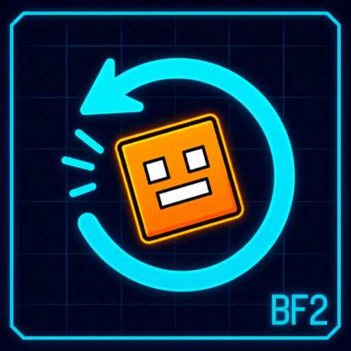

# Click Before Frames — v2.0.0

<p align="center">
  
</p>

**English** | [Bahasa Indonesia](README.id.md)

> **Developer:** Aluxs &nbsp;•&nbsp; **GitHub:** [@Aluxs-arch](https://github.com/Aluxs-arch)
> A Geode mod for Geometry Dash 2.2081 (Windows, Android, macOS; iOS source-ready).

A Geode mod that registers your clicks **ahead of** each visual frame instead
of somewhere in the middle of it. It is a fork of
[Click Between Frames](https://github.com/theyareonit/Click-Between-Frames) by
theyareonit, with an adaptive "Before Frame" scheduler, two languages (English
+ Bahasa Indonesia), and Aluxs branding. **v2.0.0** makes the lead adaptive,
adds presets, per-input leads and in-game diagnostics.

📐 Deep dive: [How "Before Frame" works](docs/HOW_IT_WORKS.md) (bilingual, with
a frame/step timing diagram).

## What "Before Frame" means

Vanilla Geometry Dash (and CBF) collects input events during the interval
between two rendered frames and then simulates the physics steps of the next
frame. Classic CBF replays every click at its *exact* sub-frame position, which
removes the 240 TPS precision limit.

**Click Before Frames** pulls every click earlier by a **lead**, clamped to the
start of the frame's physics interval. The click is therefore applied *before*
the visual frame rather than at the exact point where it was rendered:

* With a **one-step** lead (v2 default, Auto), a late click is applied one
  physics step earlier — about 4.17 ms at 60 FPS.
* With a **full-frame** lead (16.67 ms at 60 FPS, or the `Full Frame` preset),
  every click lands on the **first** physics step, before the frame is drawn.

Two safety rules keep the physics honest:

* A click is never moved before the start of the current physics interval, and
  the lead is always clamped to the measured frame interval.
* A click that happened at/after the frame boundary is **not** pulled back into
  the frame; it stays queued for the next frame, exactly like vanilla CBF. The
  transform is monotonic, so press/release order is always preserved.

Leads are disabled when the mod is soft-disabled, in **Click on Steps** mode
(vanilla parity), on death, while paused, on the end screen, or in the editor.

> ⚠️ Shifting clicks earlier changes the timing of your inputs. Some lists and
> leaderboards that allow CBF may **not** allow this. Use **Safe Mode** and
> check the rules of your list/leaderboard before submitting runs.

## What's new in v2.0.0

| Feature | EN | ID |
| ------- | -- | -- |
| **Adaptive lead (Auto)** | Lead = one real physics step of the current frame, so it adapts to FPS, timewarp, lag and Physics Bypass instead of a fixed 4.17 ms | Jeda = satu step fisika asli frame saat ini, menyesuaikan FPS, timewarp, lag, dan Physics Bypass |
| **Presets** | `Custom`, `Vanilla`, `One Step`, `Half Frame`, `Full Frame` | `Custom`, `Vanilla`, `One Step`, `Half Frame`, `Full Frame` |
| **Per-input leads** | Separate scales for releases and Player 2 in duals (0–200%); `0%` keeps exact sub-frame timing | Skala terpisah untuk pelepasan dan P2 saat dual (0–200%); `0%` mempertahankan waktu sub-frame persisnya |
| **Debug overlay** | Measured frame time, current step `n/total`, clicks moved to step 0, latency saved | Interval frame terukur, step `n/total`, klik yang pindah ke step 0, latensi yang dihemat |
| **End-screen stats** | Localized click count / first-step count / ms saved | Jumlah klik / jumlah ke step pertama / ms yang dihemat |
| **Watermark** | `BF2` / `BF2+PB` | `BF2` / `BF2+PB` |
| **Tests** | 50+ assertions incl. randomized input-order monotonicity | 50+ assertion termasuk monotonisitas urutan input secara acak |

## Two languages / Dua bahasa

The mod ships with exactly two languages:

| Code | Language | In-game file |
| ---- | -------- | ------------ |
| `en` | English | [`resources/lang/en.lang`](resources/lang/en.lang) |
| `id` | Bahasa Indonesia | [`resources/lang/id.lang`](resources/lang/id.lang) |

Switch with **Language / Bahasa** in the mod settings. It affects the in-game
status label, the debug overlay, end-screen caption/credit/statistics, and the
Linux/Wine error popup. Strings are also compiled into the binary as a
fallback. Mod-setting names and descriptions are written in both languages
inline, because Geode's settings UI has no per-language lookup.

Documentation is bilingual too: this file is English,
[`README.id.md`](README.id.md) is Indonesian, [`about.md`](about.md) /
[`changelog.md`](changelog.md) / [`docs/HOW_IT_WORKS.md`](docs/HOW_IT_WORKS.md)
contain both.

## Installation

1. Install [Geode](https://geode-sdk.org/install/) **5.6.0 or newer**.
2. Install **Click Before Frames** (from the Geode index, or build the `.geode`
   package yourself — see [Building](#building)).
3. Do **not** enable Click Between Frames or CBF Lite at the same time; they are
   marked as incompatible because they hook the same functions.

## Settings

| Setting | EN | ID |
| ------- | -- | -- |
| `language` | Language | Bahasa |
| `soft-toggle` | Disable the mod without restarting | Nonaktifkan mod tanpa restart |
| `before-frame` | Pull clicks earlier (before the frame) | Geser klik lebih awal (sebelum frame) |
| `preset` | Quick profile: Custom / Vanilla / One Step / Half Frame / Full Frame | Profil cepat |
| `lead-mode` | Auto (one real physics step) or Manual | Auto (satu step fisika asli) atau Manual |
| `before-frame-lead` | Manual lead in ms (0–16.67) | Jeda manual dalam ms |
| `separate-leads` | Enable per-input scales | Aktifkan skala per-input |
| `release-lead-scale` | Lead % for release inputs | % jeda untuk input lepas |
| `p2-lead-scale` | Lead % for Player 2 | % jeda untuk Player 2 |
| `show-indicator` | Small localized status label | Label status kecil |
| `show-debug-overlay` | Frame/step/lead diagnostics (calibration) | Diagnostik frame/step/jeda (kalibrasi) |
| `safe-mode` | Disable progress/stats on rated levels | Nonaktifkan progres pada level ber-rating |
| `click-on-steps` | 240 TPS precision, vanilla-like physics | Presisi 240 TPS |
| `mouse-fix` / `precision-fix` | Windows performance fixes | Perbaikan performa Windows |
| `physics-bypass` / `bypass-mode` | Optional built-in Physics Bypass | Physics Bypass bawaan (opsional) |
| `wine-workaround` / `right-click` | Linux/Wine input options | Opsi input Linux/Wine |

## How to use

* If the icon automatically jumps when you respawn, disable **Stop Triggers on
  Death** in Mega Hack.
* To edit keybinds, open GD Options → **Keys** (requires Custom Keybinds).
* Use Physics Bypass or one of these FPS values: 60, 80, 120, 240. 2.2 stutters
  on other values unless you enable Physics Bypass.
* Disable TPS Bypass / Draw Divide — they are pointless with this mod. The mod
  overrides the vanilla *Click On Steps* / *Click Between Steps* options.
* On Linux/Wine, if input does not work, run `sudo usermod -aG input $USER`
  (this slightly reduces system security) and reboot.
* Start with **Auto** + preset `Custom`. Turn on **Show Debug Overlay** to see
  your real frame interval and calibrate a manual lead if needed. For orb-heavy
  levels, enable **Separate Leads** and set `Release Lead` to `0%`.
* Use `Vanilla` preset or turn **Before Frame Mode** off for classic
  between-frames precision (drop-in CBF replacement).

## Known issues

* Does not work with bots.
* Linux/Wine controller support is experimental.
* Because clicks are applied earlier, replays/macro recordings made with other
  input mods may desync.
* The iOS binary is pending an upstream Geode bindings issue (see Releases).

## Building

Requires the [Geode SDK](https://docs.geode-sdk.org/getting-started/) and
CMake 3.21+ / a C++23 compiler.

```bash
geode build            # or: cmake -B build -DGEODE_SDK=... && cmake --build build
bash tests/run.sh      # engine-independent logic + i18n + JSON checks (50+ assertions)
```

`resources/linux-input.so` is a generated helper for Linux/Wine builds (it is
gitignored). Build it locally with `bash src/linux/build.sh` (needs
`libevdev-dev`), or let CI generate it.
`.github/workflows/multi-platform.yml` runs the unit tests, builds Windows,
macOS, Android32 and Android64 packages (plus a best-effort iOS build), merges
them into one `.geode` file and publishes it as a GitHub Release asset.

## Releases

Prebuilt packages are attached to the
[GitHub Releases](https://github.com/Aluxs-arch/Click-Before-Frames/releases):
`click-before-frames-v2.0.0.geode` (Windows, macOS, Android32, Android64).
Install it by opening the `.geode` file with Geode, or drop it into your Geode
mods folder. v1.0.0 remains available as a separate release.

> The iOS binary is currently blocked by an upstream Geode bindings issue
> (FMOD types in the generated bindings source), not by this mod's code. The
> source still builds `src/main.cpp` / `src/i18n.cpp` for iOS; an iOS binary
> will be added once the upstream toolchain is fixed.

## Credits & license

* **Developer:** Aluxs — GitHub [@Aluxs-arch](https://github.com/Aluxs-arch)
* Original mod: [Click Between Frames](https://github.com/theyareonit/Click-Between-Frames)
  by theyareonit (syzzi), MIT licensed. The physics/input hook code in `src/`
  is derived from it.
* Android, macOS & iOS input code based on
  [Click on Steps by zmx](https://github.com/qimiko/click-on-steps), used with
  permission by the original project. Android port by
  [mat](https://github.com/matcool), macOS & iOS ports by
  [Jasmine](https://github.com/hiimjasmine00). Original icon by alex/sincos.
* This fork adds the Before Frame scheduler (v2: adaptive lead, presets,
  per-input scales, diagnostics, statistics), the two-language system, the
  localized UI, documentation and tests.

MIT — see [LICENSE](LICENSE). Original copyright notices are preserved.
